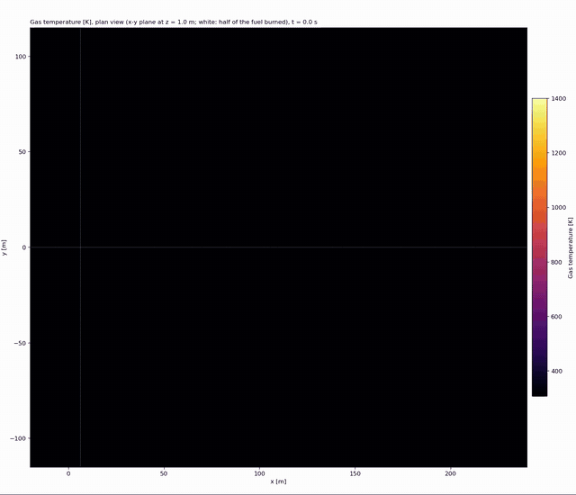
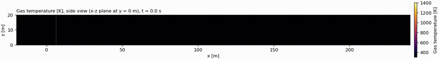
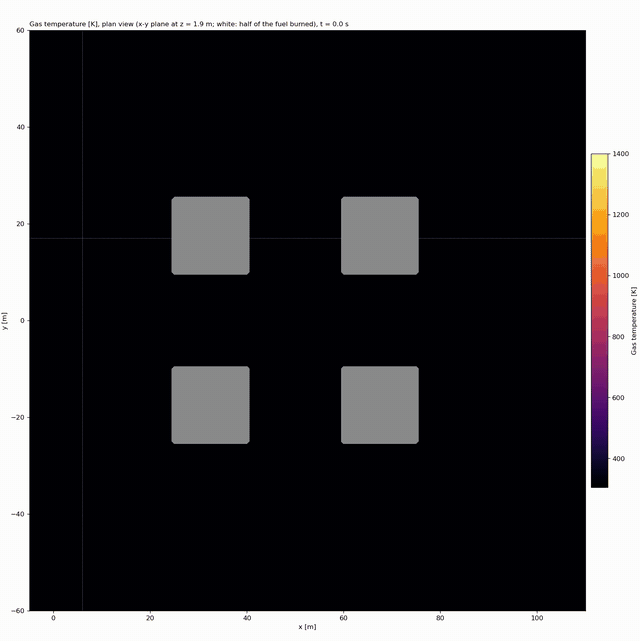
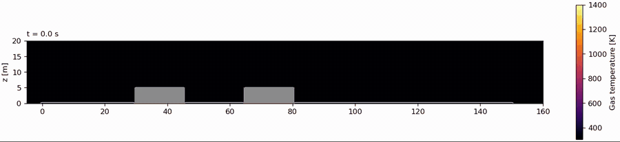

# Coupled Atmosphere-Wildfire Model

A coupled atmosphere–fire model for grassland and wildland–urban interface (WUI) fires, in 2D and 3D, written in
PyTorch to run on GPUs. It started as the 2D model of San Martín & Torres (2025); this branch extends it with a
solid fuel phase, gas-phase combustion, radiation transport, turbulence and wall models, a conservative
low-Mach solver, a stretched vertical grid, and burning structures. It is validated against the CSIRO
grassland fires F19 and C064 and compared with FDS.

* `src/`: the current model (PyTorch, CPU or GPU, 2D and 3D). Usage and options: [src/README.md](./src/README.md).
* `docs/wildfire_model.pdf`: full description of the model, its numerics, validation and limitations
  ([source](./docs/wildfire_model.tex)).
* `src_legacy/`: the published 2D model, reproduced to round-off by `src/main.py --legacy`. The `main` branch
  holds the published code.

## Mathematical model

**Gas phase (low Mach number).** The thermodynamic pressure is constant, so density and temperature are tied by
the gas law, and mass conservation becomes a constraint on the divergence of the velocity:

$$
\rho = \frac{\rho_\infty T_\infty}{T},\qquad
\nabla\cdot\mathbf{u} = \frac{\dot q}{\rho c_\text{p} T} + \frac{\dot m'''}{\rho},
$$

$$
\frac{\partial\rho}{\partial t} + \nabla\cdot(\rho\mathbf{u}) = \dot m''',
$$

$$
\frac{\partial\mathbf{u}}{\partial t} + (\mathbf{u}\cdot\nabla)\mathbf{u}
  = -\frac{1}{\rho}\nabla p + \nu\nabla^2\mathbf{u} + \frac{\nu}{3}\nabla(\nabla\cdot\mathbf{u})
  + \frac{\rho-\rho_\infty}{\rho}\,\mathbf{g} - \tfrac12 C_\text{d}\,\alpha_\text{s}\sigma_\text{s}Y\,|\mathbf{u}|\,\mathbf{u}
  - \boldsymbol{\tau}_\text{sgs} + \mathbf{f},
$$

with the net heating of the gas (conduction, radiation absorbed minus emitted, combustion, heat given to the
fuel)

$$
\dot q = \nabla\cdot(\kappa\nabla T) + \kappa_\text{g}\,(G - 4\sigma T^4) + \dot\omega_\text{F} H_\text{C} - Q_\text{conv}
$$

and $\dot m'''$ the gas added by pyrolysis, the ignition burner and burning structures. The density is
transported conservatively and $T$ follows from it, which conserves mass exactly and mixes hot and cold gas at
the mass-weighted temperature.

**Fuel gas and oxygen, mixing-limited combustion:**

$$
\frac{\partial(\rho Y_\text{F})}{\partial t} + \nabla\cdot(\rho\mathbf{u}Y_\text{F}) = \nabla\cdot(\rho\mathcal{D}_\text{eff}\nabla Y_\text{F}) + \dot m''' - \dot\omega_\text{F},\qquad
\frac{\partial(\rho Y_{\mathrm{O_2}})}{\partial t} + \nabla\cdot(\rho\mathbf{u}Y_{\mathrm{O_2}}) = \nabla\cdot(\rho\mathcal{D}_\text{eff}\nabla Y_{\mathrm{O_2}}) - s\,\dot\omega_\text{F},
$$

$$
\dot\omega_\text{F} = \frac{\rho\,\min(Y_\text{F},\,Y_{\mathrm{O_2}}/s)}{\tau_\text{mix}},\qquad \tau_\text{mix}=\sqrt{2\Delta/|g|}.
$$

**Solid fuel** (fraction left $Y$, temperature $T_\text{s}$, moisture $W$; surface per volume $a=\alpha_\text{s}\sigma_\text{s}Y$):

$$
\rho_\text{b}\,(Y c_\text{s} + W c_\text{w})\,\frac{dT_\text{s}}{dt} = Q_\text{conv} + Q_\text{rad} - \dot m''' H_\text{pyr},\qquad
Q_\text{conv} = h\,a\,(T - T_\text{s}),\qquad Q_\text{rad} = \frac{a}{4}\,(G - 4\sigma T_\text{s}^4),
$$

$$
\rho_\text{b}\frac{dY}{dt} = -\dot m''',
$$

with the pyrolysis rate $\dot m'''$ either linear in the heat received between two temperatures (default, after
Mell et al. 2007) or Arrhenius, $\dot m''' = \rho_\text{b}\,A\,e^{-T_\text{act}/T_\text{s}}\,Y$ (the FDS kinetics,
used in the validation runs). Wet fuel evaporates at the boiling point before it pyrolyses.

**Radiation:** gray discrete ordinates, $\boldsymbol{\Omega}\cdot\nabla I = \kappa\,(I_\text{b} - I)$,
$G=\int_{4\pi} I\,d\Omega$, with gas and fuel absorption $\kappa = \kappa_\text{g} + \alpha_\text{s}\sigma_\text{s}Y/4$.
**Turbulence:** Smagorinsky with Van Driest damping, and a log-law wall model at the ground.

**Burning structures** (`[structures] model = ignition`): every building surface element has 1D heat conduction
through layered walls, heated by convection and radiation; when its surface reaches the ignition temperature it
releases fuel gas at a prescribed heat release rate per unit area, which burns in the gas phase, as with the FDS
`IGNITION_TEMPERATURE` and `HRRPUA` surfaces.

**Numerics:** collocated grid, periodic horizontal directions with a sponge zone that returns ambient air
upstream, face-based projection (preconditioned conjugate gradients with an FFT and eigendecomposition
preconditioner), Koren-limited conservative transport, adaptive time step, optional stretched vertical grid,
single or double precision, CUDA graphs and restart. Details in the [documentation](./docs/wildfire_model.pdf).

## Validation: CSIRO grassland fires

No parameter was tuned to the measurements; fuel, kinetics and burner are those of the FDS validation cases.

**F19** (200 m × 200 m plot, 3D, stretched vertical grid, head-fire position):

| | 56 s | 86 s | 138 s | wall clock (140 s) |
|---|---|---|---|---|
| measured | 80 m | 120 m | 200 m | |
| this model, RTX 4090 | 75 m | 125 m | 200 m | 1.5 h |
| FDS 0.5 m, 24 CPU cores (same workstation) | 64 m | 111 m | 189 m (200 m at 146 s) | 10.5 h |

**C064** (100 m × 100 m plot, head-fire position): the model reaches the end of the plot at 79 s (measured
100 s, FDS 93 s); it is ahead while the line is lit and spreads about 15% faster than measured afterwards. On
the stretched grid the 120 s run took 35 min on the GPU, against 55 min for FDS at 0.5 m on 36 CPU cores of the
same workstation.

Open issues: the fire does not spread sideways beyond the ignition line (missing flank spread). See the
limitations and next steps in the documentation.

## Examples

### F19 in 3D (temperature at 1 m height; white: half of the fuel burned)




### C064 with four burning houses (3D, temperature at 2 m height)
The upwind houses ignite within 3 s of FDS; the grass fire passes between them.



### Two houses in 2D (gas temperature)
The flame of the first house ignites the second one across a 20 m gap.



### More
See more, including the simulations of the published 2D model, **[here](./examples/README.md)**.

## Running

Requirements: Python 3 with PyTorch, NumPy, SciPy and Matplotlib (ffmpeg or `imageio-ffmpeg` for MP4
animations). The scripts write their own parameter files to `data/input/` and the results to `data/output/`:

```bash
bash scripts/f19_3d.sh smoke          # 3 s check of the 3D F19 case (GPU)
bash scripts/f19_3d.sh sz_full        # full F19 run on the stretched grid (about 1.5 h on an RTX 4090)
bash scripts/houses_2d.sh             # burning structures in 2D
python src/visualize.py data/output/NAME --field T HRR      # snapshots and animations
python src/firefront.py data/output/NAME --obs validation/csiro/F19_front.csv
```

All scripts and options are described in [src/README.md](./src/README.md).

## Reference

* San Martín, D., & Torres, C. E. (2025). **Simplified coupled atmosphere‑fire model for simulation of 2D wildland
  fires**. Computer Physics Communications. https://doi.org/10.1016/j.cpc.2025.109746
