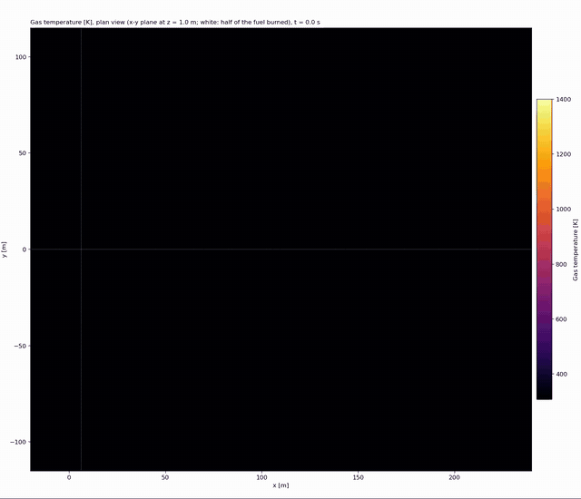
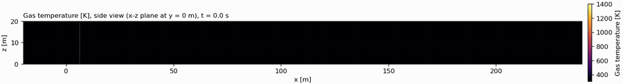
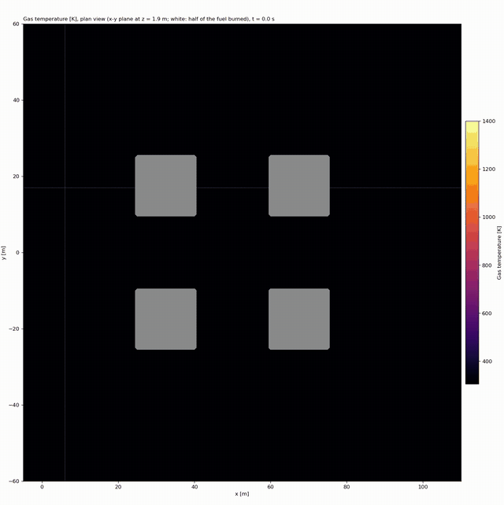
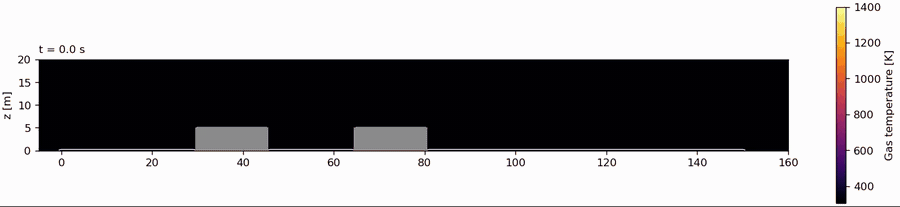
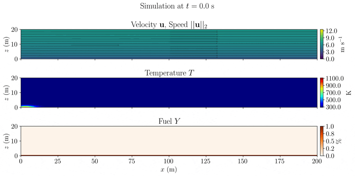
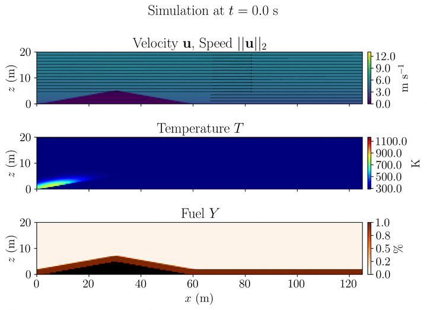
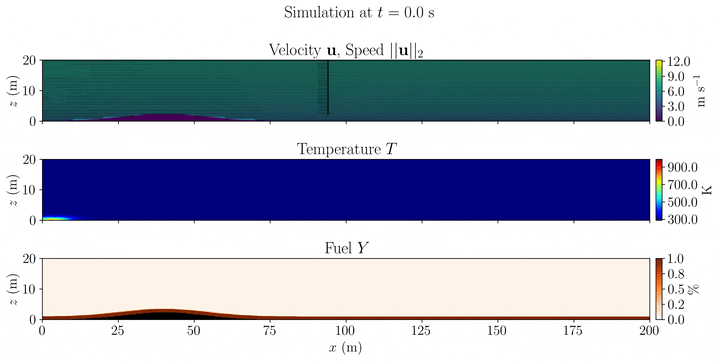
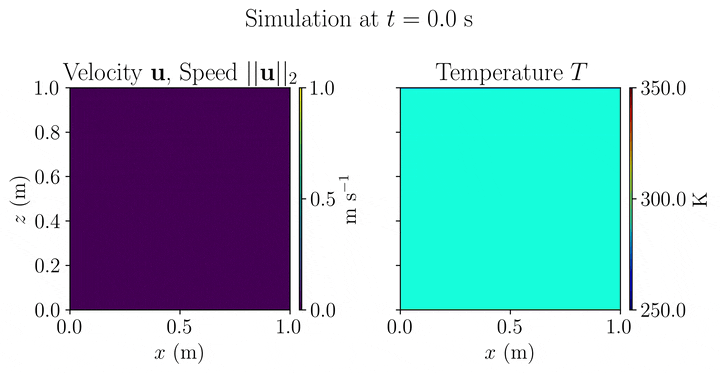
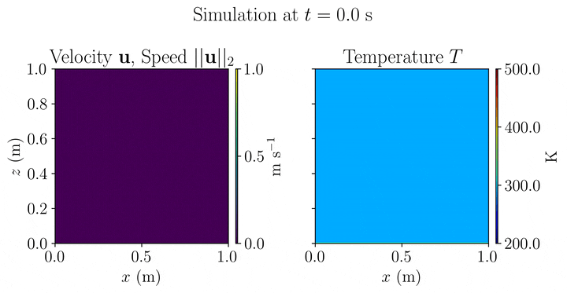

# Numerical simulations

## Current model (`src/`)

### CSIRO grassland fire F19, 3D (stretched vertical grid, 140 s)

Plan view, gas temperature at 1 m height (white: half of the fuel burned):

Side view through the center of the fire:

### C064 with four burning houses, 3D (FDS structures case, 120 s)

Gas temperature at 2 m height. The upwind houses ignite at 35 s (FDS: 32-34 s); the downwind ones ignite later
than in FDS, because the grass fire does not spread sideways behind the upwind houses.

### Two houses 20 m apart, 2D (120 s)

The flame of the first house ignites the second one 39 s later; the grass in the gap burns afterwards from the
wake of the first house.

## Published 2D model (`src_legacy/`, `--legacy`)

### Flat terrain

#### Case F19

### Topography

#### Triangular hill

#### Gaussian hill

### Validation

#### Rayleigh–Bénard convection

##### Temperature difference $30$ K

##### Temperature difference $100$ K
